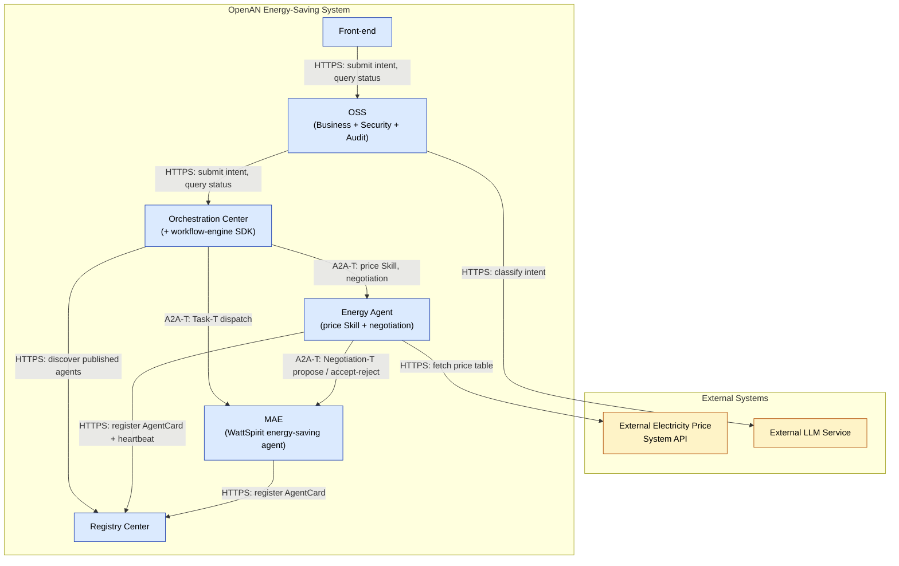
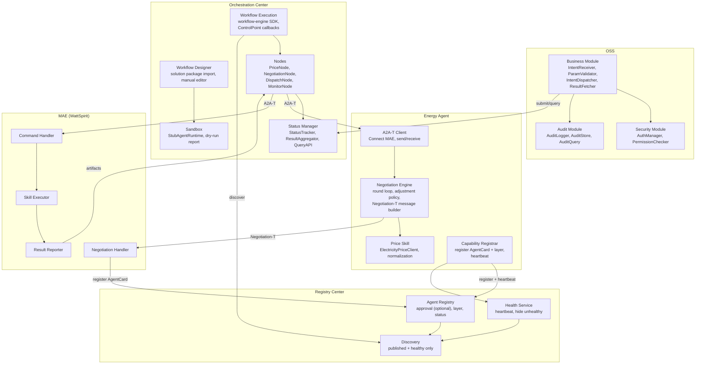
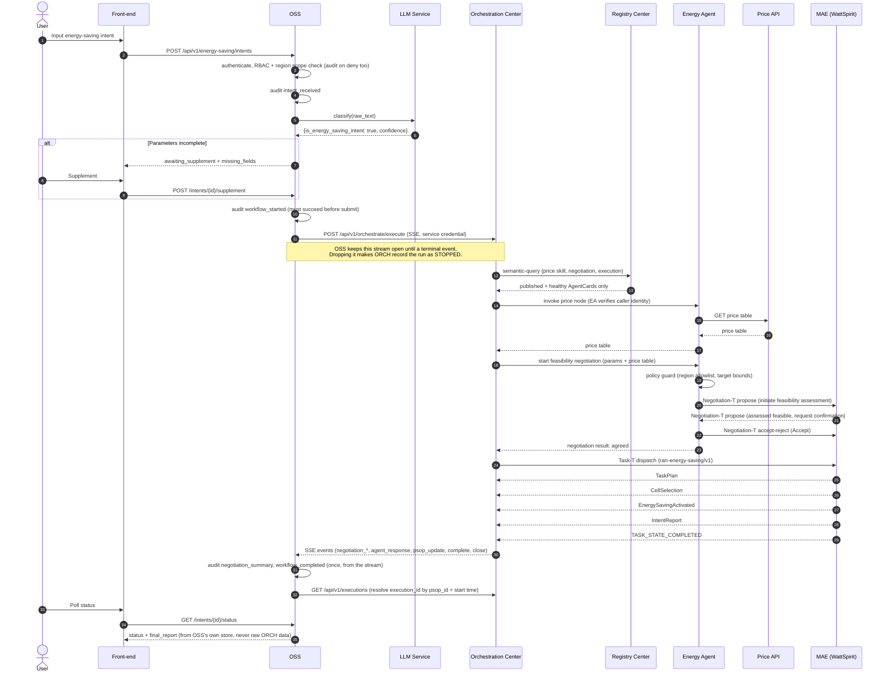
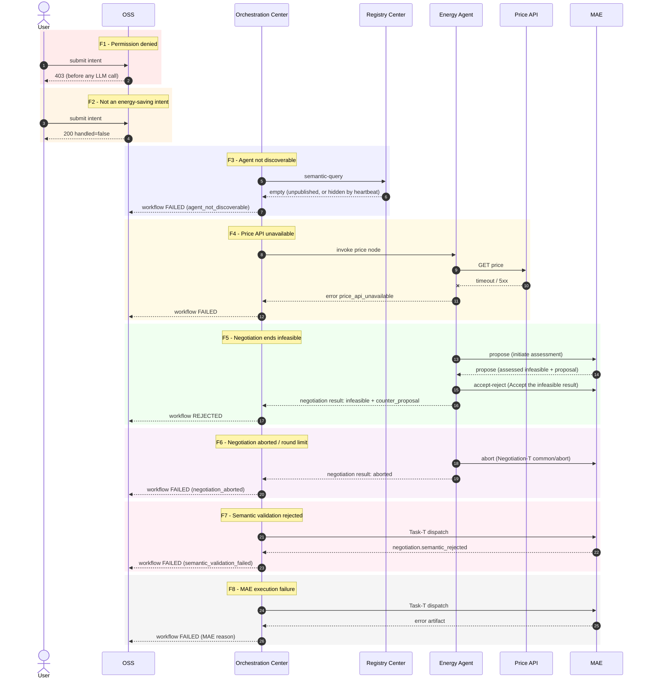
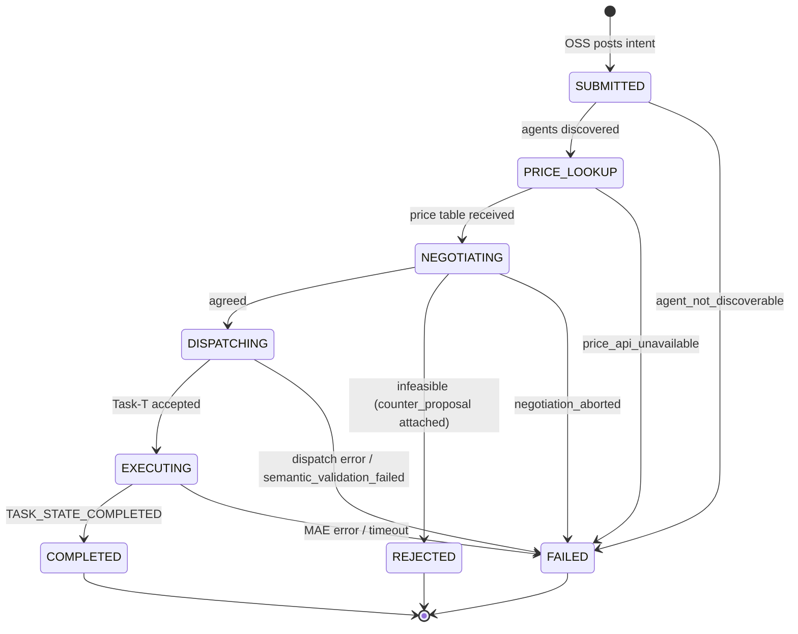
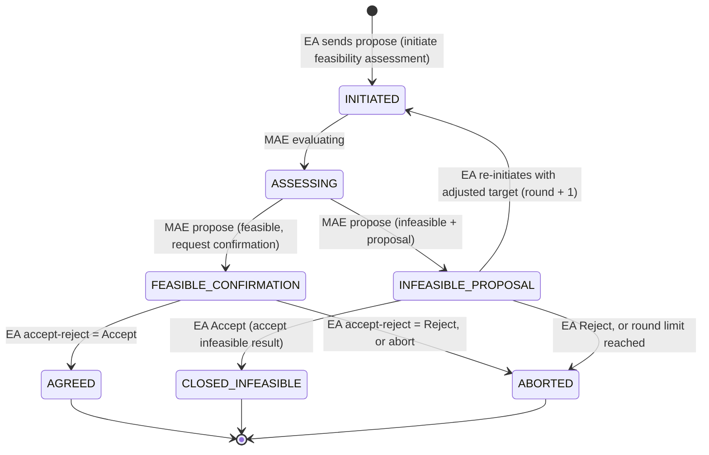
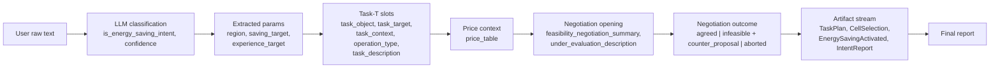
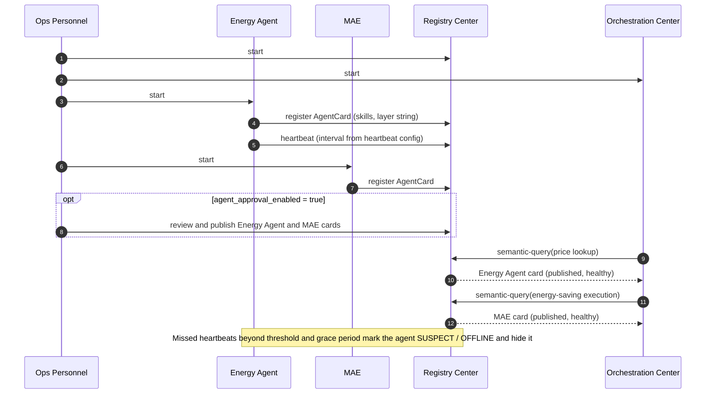
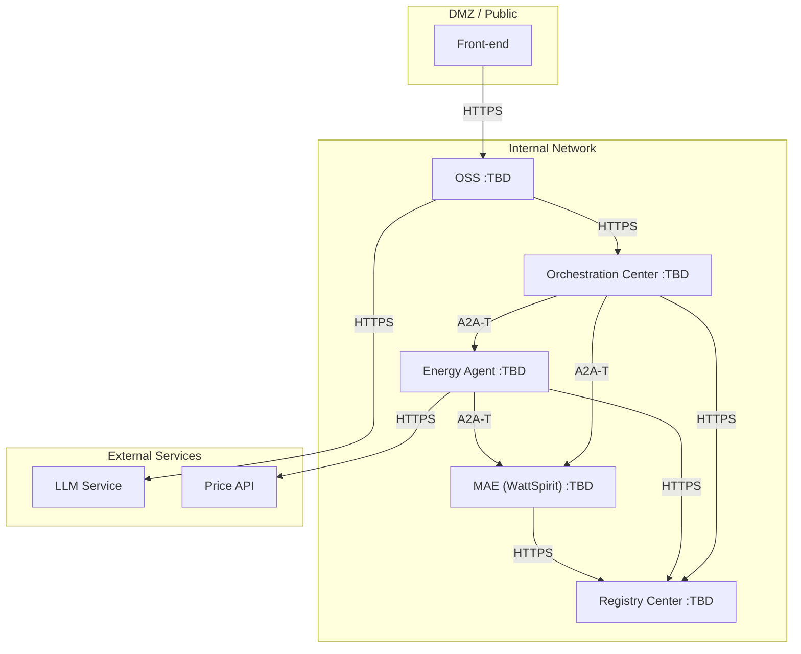
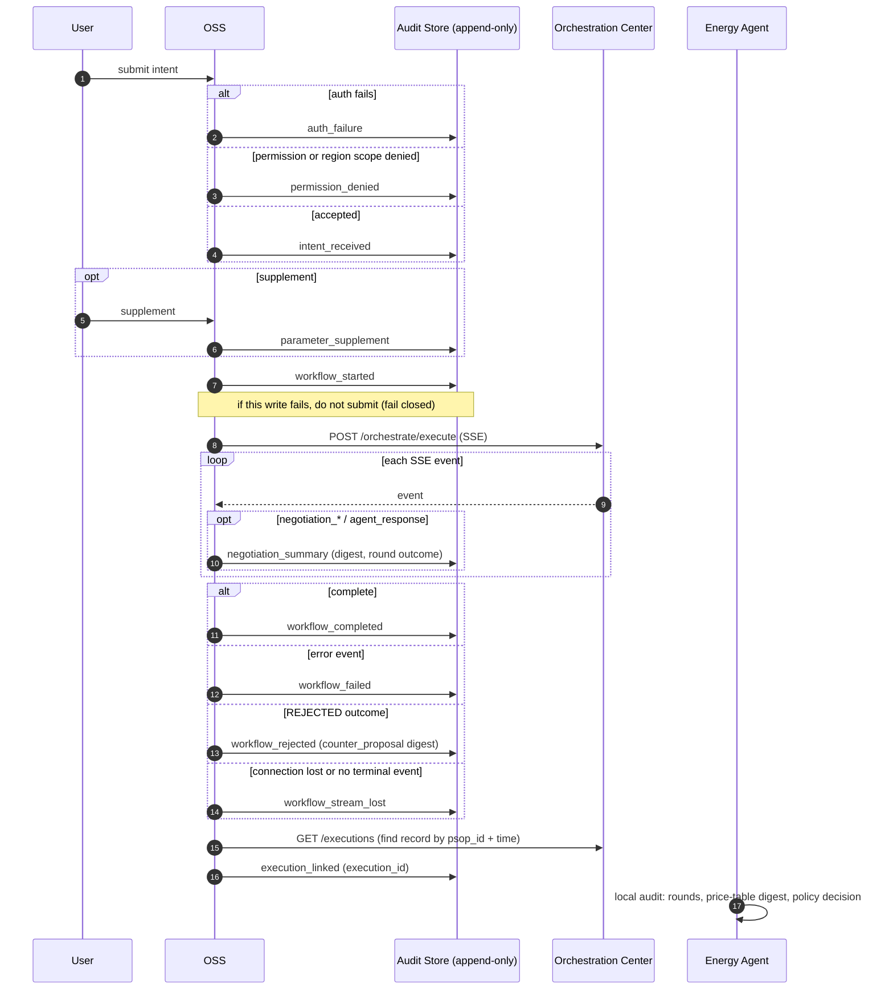

# [US202610010001] OpenAN Energy-Saving Function — Low-Level Design (LLD)

**Based on:** *OpenAN Energy-Saving Function Software Design Specification v1.0.0 (2026-10-01)*
**Supersedes:** LLD v10.3 (and v10.2, v0.1.0–v0.5.0)
**File:** `US202610010001-energy-saving-LLD-v10.4.md`
**Baseline verified against:** public `project-openan` repositories, default branches, commits up to 2026-10-12

---

## Revision History

| Version | Date | Description | Author |
|---|---|---|---|
| 0.1.0 | 2026-10-06 | Initial LLD derived from the HLD's 9 function points and runtime views | - |
| 0.2.0 | 2026-10-06 | Merged specification + LLD draft; ASCII diagrams, state machines, error taxonomy, open-items register | - |
| 0.3.0 | 2026-10-06 | Incorporated public Huawei MAE / RAN Multi-Agent System information | - |
| 0.4.0 | 2026-10-06 | Added Mermaid diagrams for all module interactions; interaction matrix | - |
| 0.5.0 | 2026-10-12 | Reconciled with the verified state of the public OpenAN repos. Replaced the one-shot feasibility JSON with the real multi-round Negotiation-T exchange; added registry discoverability rules (approval, heartbeat, layer); added sandbox dry-run, workflow-engine SDK and solution-package source to the workflow design; added Authorization-T and observability considerations; scoped UC2 out; updated open items | - |
| 10.3 | 2026-10-12 | Current baseline. Renumbered onto the v10.x line (v0.1.0–v0.5.0 above were working drafts). Submit path corrected to `POST /api/v1/orchestrate/execute`; O-19 (SSE ordering) and O-20 (submit endpoint) resolved against orchestration-center main; O-21 added | - |
| 10.4 | 2026-10-16 | **Security and audit designed in full** (§11.2, §11.3, §17), under the constraint that Orchestration Center and Registry Center code does not change. Execution model corrected: the execution record is created only when the SSE stream ends and its id is not in the stream, so OSS must hold the stream open and audit from it (not poll). O-21 resolved; O-22 to O-26 added | - |

---

## 0.0 Constraint and Highlights for v10.4

> **Constraint (applies to the whole design):** `orchestration-center` and `registry-center` source code is **not modified**. Only new parts are added: OSS, Energy Agent, new workflow definition and node configuration, and the MAE contract. Anything either center does not do must be done by a new component or by configuration of the existing one.

> 🔒 **SECURITY** is in §11.2 (OSS), §11.4 and §11.11 (Energy Agent), §11.10 (network-change authorization) and the control matrix in §17.
> 🧾 **AUDIT** is in §11.3 (events, schema, integrity), §9 (flow) and §17.
> Both are marked **NEW v10.4** where they were absent or wrong before.

**What the unchanged centers do and do not give us (verified in source, 2026-10-16):**

| Fact | Consequence for this design |
|---|---|
| ORCH external API auth is selectable by configuration: `user` (default), `mtls`, `bearer` (`ORCH_API_TOKEN`, at least 32 bytes) or `custom`. It yields **one machine identity**, not the end user | OSS authenticates users; ORCH only ever sees OSS's service identity. Pick `mtls` or `bearer` by configuration, no code change |
| ORCH has **no per-user ownership or roles** on executions. `GET /api/v1/executions` and `/{id}` return any record to any authenticated caller | ORCH must be reachable **only from OSS**. OSS never relays raw ORCH responses to users |
| The ORCH execution record is created **when the SSE stream ends**, and its `execution_id` is **not carried in the stream** (events carry the workflow/PSOP id) | Polling `GET /executions/{id}` during a run is impossible. OSS holds the stream and is the continuous observer |
| If the SSE client disconnects early, ORCH records the run as `STOPPED` ("stream closed before execution completed") | A dropped OSS connection must be audited as `workflow_stream_lost`. Keep the connection alive, and reconnect logic cannot resume |
| ORCH and Registry emit no OpenTelemetry; ORCH has built-in rate limiting and busy semaphores (`503`) | `trace_id` lives in OSS and Energy Agent audit; map `503` to a retryable error |

---

## 0. Changes from v0.4.0 (carried into v10.4)

| # | v0.4.0 said | Verified fact (2026-10-12) | Effect in v0.5.0 |
|---|---|---|---|
| C1 | Feasibility negotiation is one request and a `{feasible: true/false}` reply | `Negotiation-T/feasibility-negotiation` has two message templates, **propose** and **accept-reject**, plus `Negotiation-T/common/abort`. A round can end in a counter-proposal (the template's own example lowers a rate goal from 5 Mbps to 2 Mbps). | §11.5 rewritten; new negotiation state machine (§5.2); `REJECTED` now carries the counter-proposal |
| C2 | Agents are found through Registry semantic-query | A card is discoverable only if it is **published** and **not hidden by heartbeat detection**. `agent_approval_enabled` defaults to `false`. Layer is a free-form string, not an enum. | §7, §16 and §18 updated; new error `agent_not_discoverable` |
| C3 | Workflow is built by hand or imported | Orchestration Center ships a **sandbox dry-run** (stub agents) and a pre-seeded **TM Forum IG1526A "AN L4 Wireless Energy Efficiency Optimization" solution package** | §11.6: build the PSOP from the package, verify it in the sandbox before live runs |
| C4 | Workflow nodes reference agents by name | **Role-based orchestration** (requirement 8) and **layer-order enforcement** (requirement 26) are **not implemented** | New assumptions 9 and 10; nothing in this design relies on either |
| C5 | Security enforced at the OSS boundary only | Energy saving **changes the live network**. A2A-T has an **Authorization-T** extension for that case. | New open item O-12; §17 |
| C6 | Observability not covered | OpenTelemetry exists in the **Python SDK only**. Orchestration Center and Registry Center have none. | New §11.9; trace gaps documented |
| C7 | UC2 (battery) implied to be nearby | The new `ran-intelligent-backup-battery-endurance` template is **outage tiered power-down**, not **price-based charge/discharge** | UC2 explicitly out of scope (assumption 11) |
| C8 | Glossary: A2A-T = "Agent-to-Agent Trusted interface" | OpenAN sources expand it inconsistently ("with Telemetry", "Trusted"); the extension URI namespace is `telecommunication` | Glossary corrected |
| C9 (v10.4) | Audit events fire when status polling first sees a terminal state | Execution id is unknown until the stream ends; terminal states are visible in the SSE stream | 🧾 Audit is driven by OSS's SSE watcher, not by polling (§9, §11.3) |
| C10 (v10.4) | Permission denials are not audited | Denials and auth failures are the most useful security signal | 🧾 `auth_failure` and `permission_denied` are audited (§11.3) |
| C11 (v10.4) | Authorization only at OSS | ORCH, Energy Agent and MAE would trust any caller that reaches them | 🔒 Service authentication on every hop, an Energy Agent policy guard, and network isolation of ORCH (§11.2, §11.11, §17) |
| C12 (v10.4) | OSS polls `GET /executions/{id}` | See C9; the record exists only after completion | §3, §11.8, §13.2 rewritten |
| C13 (v10.4) | O-21 open | `external_auth.py` read: four modes, one machine identity | O-21 resolved; O-22 to O-26 added |

---

## 0.1 Traceability — FP → LLD Section

| FP ID | FP Name | Priority | LLD Section(s) |
|---|---|---|---|
| FP-001 | Intent reception, recognition & validation | High | §11.1, §12, §13.1, §3 |
| FP-002 | Energy-saving intent negotiation | Medium | §11.5, §5.2, §12, §13.4, §14 |
| FP-003 | External electricity price acquisition | High | §11.4, §13.4, §3 |
| FP-004 | External LLM adaptation | High | §11.1, §15 |
| FP-005 | Invoke Orchestration Center | High | §11.1, §11.6, §13.2 |
| FP-006 | Orchestrate energy-saving workflow | High | §11.6, §7, §5.1 |
| FP-007 | Energy-saving report display | Medium | §11.8, §13.1 |
| FP-008 | Permission control | Medium | §11.2, §17 |
| FP-009 | Operation audit | Low | §11.3, §9, §17 |

## 0.2 Verified Baseline (public repos, 2026-10-12)

| Component | What exists | What it means here |
|---|---|---|
| **a2a-t-sdk-python** | Task-T `ran-energy-saving/v1` (slots: `operation_type`, `task_description`, `task_object`, `task_target`, `task_context`, `expected_output`); Negotiation-T information / target / feasibility (propose + accept-reject) and `abort`; Authorization-T `authorization-policy-management`; OpenTelemetry instrumentation; corpus cases for ran-energy-saving information, target and feasibility negotiation | Energy Agent reuses templates as-is; no new template needed for UC1 |
| **registry-center** | `/rest/v1/registry-center/agent-cards` (+ `/semantic-query`, `agent-cards-with-layer/...`); optional approval; heartbeat with failure threshold and grace period; layer metadata; published-only discovery | Registration alone does not guarantee discoverability |
| **orchestration-center** | PSOP engine, sandbox dry-run with `StubAgentRuntime`, MySQL/PostgreSQL storage, fail-closed startup security check, IG1526A energy solution package pre-seeded | Workflow can be generated and dry-run, not hand-coded |
| **workflow-engine-sdk** (Python 0.1.0, Java 0.1.1) | DAG execution with parallel dispatch and ControlPoint callbacks, adapted to A2A-T 1.1 | The execution substrate for §11.6 |
| **Not present** | Agent Framework repo (requirement 28), role-based orchestration, layer constraints, price-based battery template, content in `a2a-t-prompt-templates-spec` | Designed around, not on |

> **Not verified here:** MAE's real AgentCard, ports and artifact schema; the external price API; anything in private repos. See §18.

---

## 0.3 Module Interaction Matrix

| From ↓ / To → | Front-end | OSS | LLM | Registry | Orch Center | Energy Agent | MAE | Price API | Audit |
|---|---|---|---|---|---|---|---|---|---|
| **Front-end** | — | HTTPS (intent, status) | — | — | — | — | — | — | — |
| **OSS** | HTTPS responses | — | HTTPS (classify) | — | HTTPS (submit, query) | — | — | — | internal call |
| **LLM** | — | HTTPS response | — | — | — | — | — | — | — |
| **Registry** | — | — | — | — | discovery responses | — | — | — | — |
| **Orch Center** | — | HTTPS response | — | HTTPS (discovery) | — | A2A-T (price skill, negotiation) | A2A-T (Task-T dispatch) | — | — |
| **Energy Agent** | — | — | — | HTTPS (register, heartbeat) | A2A-T response | — | A2A-T (Negotiation-T rounds) | HTTPS (price) | — |
| **MAE** | — | — | — | HTTPS (register AgentCard) | A2A-T (artifacts) | A2A-T (Negotiation-T rounds) | — | — | — |
| **Audit** | — | read-only API | — | — | — | — | — | — | — |

> The Price API is called only by Energy Agent's price Skill. Orchestration Center never calls it directly.

---

## 1. Context View



---

## 2. Component View



---

## 3. Happy-Path Sequence



> The artifact names in steps after dispatch come from the public `ran-energy-saving` sample and are the contract MAE is expected to honor. The real MAE schema is unconfirmed (O-3, O-11).

---

## 4. Failure Paths



---

## 5. State Machines

### 5.1 Workflow (owned by Orchestration Center)



### 5.2 Negotiation rounds (inside `NEGOTIATING`, owned by Energy Agent)



> `INFEASIBLE_PROPOSAL → INITIATED` (re-initiate with an adjusted target) is allowed by the template. Whether Energy Agent may do it **without the user's consent** is design decision D-1 in §11.5, defaulted to **no**.

---

## 6. Data Flow



---

## 7. Registry, Discovery and Health

A registered card is **not automatically discoverable**. Orchestration Center sees an agent only if all of these hold:

1. The card is **published**. `agent_approval_enabled` defaults to `false` (cards publish on registration); if an operator enables it, cards wait for approval.
2. Heartbeat detection has **not hidden it**. When enabled with hide-unhealthy on, agents in `SUSPECT` or `OFFLINE` state disappear from list, exact and semantic queries.
3. The same predicate applies to list, exact-match and semantic queries (requirement 29).



**Layer:** the registry stores `layer` as a free-form, length-limited string chosen by the deployer. This design assigns none by default (O-13).

---

## 8. Deployment Topology



> 🔒 **Network policy (NEW v10.4):** ORCH accepts connections only from OSS and operations hosts. Energy Agent accepts A2A-T only from ORCH. MAE accepts Negotiation-T only from Energy Agent and Task-T only from ORCH. Registry is reachable by ORCH, Energy Agent and MAE only. This is the main isolation control because ORCH has no per-user access control.

> All ports are placeholders. Earlier documents quote defaults of 5000/5001, but the public repos have since changed health-probe and platform-port handling, so **read the current defaults from each repo before fixing them** (O-4).

---

## 9. Audit Event Flow 🧾 (rewritten in v10.4)

Audit is written by OSS from what it observes: its own request handling and the SSE stream it holds. It is not driven by status polling.



Terminal events are written once per workflow, keyed by `intent_id`. The Energy Agent keeps its own append-only log, joined to OSS's by `trace_id`.

## 10. Design Assumptions

1. **Energy Agent reuses `Task-T/network-layer/ran-energy-saving/v1`.** HLD fields map onto `task_object`, `task_target`, `task_context`. *(Verified: template exists.)*
2. **Negotiation is a multi-round Negotiation-T feasibility exchange** of the "goal achievement" category, using the propose and accept-reject templates and `abort`. *(Verified: templates and corpus case exist.)*
3. **MAE is Huawei iMaster MAE with WattSpirit as the energy-saving agent**, A2A-T-native per public Huawei material. *(Taken from v0.4.0 Appendix A; not independently re-verified.)*
4. **OSS's LLM classification is a separate call** from A2A-T's own slot extraction and validation.
5. **Electricity price is a Skill exposed by Energy Agent**, called as a workflow node before negotiation.
6. **Workflow state is owned by Orchestration Center**; OSS is a thin façade.
7. **AGLink is internal to MAE** and not part of the OpenAN–MAE interface.
8. **Energy Agent does not silently relax the user's targets.** A counter-proposal is returned to the user, not applied. *(New; decision D-1.)*
9. **Workflow nodes bind to concrete agent names.** Role-based orchestration is not implemented in Orchestration Center. *(New; verified absent.)*
10. **Layer-order rules are not enforced by the engine.** No step relies on Orchestration Center rejecting a bad layer topology. *(New; verified absent.)*
11. **UC2 (price-based battery charge/discharge) is out of scope.** The public backup-battery template targets outage tiered power-down, a different use case. *(New.)*
12. **Orchestration Center and Registry Center are unchanged.** Security and audit are added only in OSS, Energy Agent, workflow definition and configuration. *(New v10.4; user constraint.)*
13. **ORCH is reachable only from OSS** (network policy). ORCH has no per-user access control, so isolation is the control. *(New v10.4.)*

---

## 11. Component Detailed Design

### 11.1 OSS — Business Module

**`POST /api/v1/energy-saving/intents`**

```json
{ "raw_text": "string", "user_id": "string", "session_id": "string (optional)" }
```

Success: `{"handled": true, "intent_id": "uuid", "status": "submitted_to_orchestration", "workflow_execution_id": "string"}`

Incomplete: `{"handled": true, "intent_id": "uuid", "status": "awaiting_supplement", "missing_fields": ["region", "experience_target"]}`

**Processing order (do not reorder):**
1. Authenticate and RBAC check, reject with `401`/`403` before any LLM call; the denial **is** audited (`auth_failure`, `permission_denied`, §11.3).
2. Audit `intent_received`.
3. LLM classify (`is_energy_saving_intent`, `confidence`).
4. Negative result: `200 {handled: false}`; **not** audited as a failure.
5. Validate the three required fields (region, saving target, experience target); derive `operation_type`.
6. Complete: audit `workflow_started`, submit to Orchestration Center. Incomplete: `awaiting_supplement`.

**Classifier output (two fields, no free text):** `{"is_energy_saving_intent": true, "confidence": 0.0}`

**Supplement:** `POST /api/v1/energy-saving/intents/{intent_id}/supplement` merges by `session_id` and re-runs step 5.

### 11.2 OSS — Security (FP-008) 🔒 (rewritten in v10.4)

OSS is the **only** place that knows who the end user is. ORCH sees OSS as a single machine identity, so everything user-specific is enforced here.

| Control | Design |
|---|---|
| **Authentication** | `AuthManager` authenticates every request (deployment's SSO/OIDC or session). Failure returns `401` and writes `auth_failure` |
| **Authorization (RBAC)** | `energy_saving:submit`, `:query`, `:admin` as before. Checked before any LLM call |
| **Region scope** 🆕 | A user may target only regions in their allowed set (`user → regions` mapping). Checked after parameter extraction and before submit. Failure returns `403` and writes `permission_denied` |
| **Object ownership** 🆕 | Status and report queries return an intent only to its owner or an `admin`. ORCH has no such check, so OSS keeps its own `intent_id → user_id` table and never proxies raw ORCH list or get responses |
| **Service credential to ORCH** 🆕 | Configure ORCH `external.auth.mode` to `mtls` (preferred) or `bearer` (`ORCH_API_TOKEN`, at least 32 bytes). OSS holds the credential in a secret store, not in code or logs. Configuration only; no ORCH change |
| **Input handling** 🆕 | `raw_text` has a length cap and is treated as data. The classifier output is schema-validated to the two allowed fields. Only structured, validated fields are forwarded; `raw_text` is not passed to ORCH, Energy Agent or MAE |
| **Rate limiting** 🆕 | Per-user limits on submit and supplement. ORCH's own busy `503` is mapped to a retryable error with `Retry-After` |
| **Transport** | TLS on every hop; mTLS between services where the platform supports it |
| **Secrets** 🆕 | Price API key, LLM keys and ORCH credential come from environment or a secret manager, are redacted from logs and audit, and have a rotation owner |

**Processing order (do not reorder):** authenticate → RBAC → audit `intent_received` → LLM classify → validate parameters → region scope → audit `workflow_started` → submit. Denials and auth failures are audited (this reverses v10.3).

### 11.3 OSS — Audit (FP-009) 🧾 (rewritten in v10.4)

**Events**

| Event | Source | Notes |
|---|---|---|
| `auth_failure` 🆕 | OSS | Identity not established; no user id, record source IP |
| `permission_denied` 🆕 | OSS | RBAC or region scope; record the permission or region refused |
| `intent_received` | OSS | After auth and RBAC pass |
| `intent_not_energy_saving` 🆕 | OSS | Classifier said no; informational, not a failure |
| `parameter_supplement` | OSS | |
| `workflow_started` | OSS | Written **before** submit; submit is blocked if this write fails |
| `negotiation_summary` 🆕 | SSE `negotiation_*`, `agent_response` | Round, outcome, counter-proposal digest |
| `workflow_completed` / `workflow_failed` / `workflow_rejected` | SSE terminal event | Once per `intent_id` |
| `workflow_stream_lost` 🆕 | OSS watcher | Connection dropped or no terminal event; ORCH marks the run `STOPPED` |
| `execution_linked` 🆕 | OSS | Records the ORCH `execution_id` once resolvable |
| `audit_read` 🆕 | OSS | Any admin read or export of audit data |

**Record schema 🆕**
```json
{
  "audit_id": "uuid",
  "ts": "RFC3339 UTC",
  "event": "string",
  "intent_id": "uuid | null",
  "trace_id": "string | null",
  "actor": {"user_id": "string | null", "source_ip": "string", "roles": ["..."]},
  "resource": {"region": "string | null", "psop_id": "string | null", "execution_id": "string | null"},
  "outcome": "success | failure | denied",
  "reason": "string | null",
  "detail_digest": "sha256 of the redacted payload",
  "prev_hash": "sha256 of the previous record",
  "hash": "sha256 of this record including prev_hash"
}
```

**Integrity and operation 🆕**
- Append-only store. The OSS database role has `INSERT` and `SELECT` only; no `UPDATE` or `DELETE`.
- Hash chain over records so tampering or gaps are detectable; a periodic verifier job reports breaks.
- Retention period and archive target are configuration (O-24). Clocks are synchronized (NTP).
- **Write failure policy:** `workflow_started` fails closed (no submit). Terminal and negotiation events are spooled to local durable storage and retried; a stuck spool raises an alert.
- Payloads are redacted before hashing and storage. Whether the raw user text is stored, or only its hash, is a compliance decision (O-5).
- The Energy Agent keeps its own append-only log (§11.11) joined to this one by `trace_id`.

**Audit is OSS-owned because the unchanged centers cannot supply it:** ORCH records its own execution events, but without end-user identity, and neither center emits tracing.

### 11.4 Energy Agent — Price Skill and Registration (FP-003)

```json
{
  "skill_id": "electricity_price_lookup",
  "input_schema": {"region": "string", "date_range": "string (optional)"},
  "output_schema": {"price_table": "array of {start_time, end_time, relative_price}"}
}
```

- Failure raises `PriceAPIUnavailableError`; the workflow fails with `price_api_unavailable`. Never return an empty table.
- **Registration:** register on startup with a deployment-defined `layer` string (O-13), then send heartbeats on the registry's configured interval. A stopped heartbeat removes the agent from discovery (§7).
- If approval is enabled in the target registry, startup is **not complete** until an operator publishes the card.
- 🔒 Registry authentication for registration and heartbeat is unverified and the registry is unchanged (O-22); use whatever the deployed registry requires, supplied by configuration.

### 11.5 Energy Agent — Negotiation (FP-002)

**Mechanism.** Messages are generated from the SDK's Negotiation-T templates, not hand-built JSON. The JSON below is the *logical* content each round carries.

| Direction | Template | Purpose |
|---|---|---|
| EA → MAE | `feasibility-negotiation/propose` | Initiate assessment; or re-initiate with an adjusted target |
| MAE → EA | `feasibility-negotiation/propose` | Report "assessed feasible, request confirmation" or "assessed infeasible, with proposal" |
| EA → MAE | `feasibility-negotiation/accept-reject` | `Accept` or `Reject`, with confirmation text; names the chosen solution if several were offered |
| either | `common/abort` | End the negotiation without agreement |

The template defines two assessment categories: **goal achievement** (can this target be met?) and **solution feasibility** (can this approach be used?). This design uses **goal achievement**.

**Opening content (EA → MAE):**
```json
{
  "category": "goal_achievement",
  "message_class": "initiate_feasibility_assessment",
  "under_evaluation_description": {
    "region": "string",
    "saving_target": "string",
    "experience_target": "string",
    "electricity_price_table": [
      {"start_time": "06:00", "end_time": "10:00", "relative_price": 0.85}
    ]
  }
}
```

**MAE's reply, logical content:**
```json
// assessed feasible
{"message_class": "feasible_request_confirmation", "selected_solution": "string (if several)"}
// assessed infeasible
{"message_class": "infeasible_with_proposal",
 "basis": "string",
 "counter_proposal": {"adjusted_experience_target": "string (optional)", "adjusted_saving_target": "string (optional)"}}
```

**Energy Agent rules:**
- Stateless per message: carry full context in every message; never assume MAE remembers a prior round (SDK 1.1 negotiation model).
- Bounded: `ENERGY_AGENT_NEGOTIATION_MAX_ROUNDS` (default 3) and a per-round timeout. On exhaustion, send `abort`.
- The agent **business logic** decides whether to initiate, re-initiate or accept; the SDK supplies message generation only.

**Design decision D-1 (needs sign-off).** When MAE reports infeasible and proposes a relaxed target, what does Energy Agent do?
- **Default in this LLD:** accept the infeasible result (`CLOSED_INFEASIBLE`), return the counter-proposal to the user through the workflow's `REJECTED` result, and let the user resubmit as a `Modify`.
- **Alternative:** re-initiate autonomously within a configured floor (`ENERGY_AGENT_ALLOW_TARGET_RELAXATION` plus a floor). This changes the user's stated experience target without consent, so it is **off by default** and should only be enabled with explicit product approval.

### 11.6 Orchestration Center Workflow (FP-005, FP-006)

**Node sequence:** `intent received → PriceNode → NegotiationNode → gateway → DispatchNode → MonitorNode → terminal`

**Source of the PSOP.** The repo ships a pre-seeded demo solution package, *TM Forum IG1526A, AN L4 Wireless Energy Efficiency Optimization v1.0.0*. Build the energy-saving PSOP by importing it (PDF/solution-package → PreFlow → PSOP), then adapt node bindings to the Energy Agent and MAE cards. This matches the HLD's "manually orchestrate or import". Manual orchestration remains the fallback.

**Execution.** Run through the workflow-engine SDK (Python 0.1.0, adapted to A2A-T 1.1). Business behavior sits in ControlPoint callbacks. The interface documented for the SDK has `on_task`, `on_self_task`, `on_route` and `on_negotiation`; re-check names against the released 0.1.0 before coding.

| Concern | ControlPoint hook | Behavior |
|---|---|---|
| Delegate price lookup and dispatch | `on_task` | Send A2A-T task to the bound agent |
| Feasible / infeasible branch | `on_route` | Route on the negotiation outcome (`agreed` → dispatch, else terminal) |
| Mid-flight negotiation requests | `on_negotiation` | Hand off to Energy Agent's round loop |

**Dry-run before live.** Orchestration Center has a sandbox mode with a `StubAgentRuntime` and a run report. Before enabling the workflow, run it in the sandbox with stub Energy Agent and MAE responses covering: normal, infeasible with counter-proposal, price API error, delayed response. This verifies DAG integrity and context passing without touching a network.

**Discovery.** Resolve agents through Registry semantic-query before the run, and fail with `agent_not_discoverable` if a required card is missing (§7). Do not fall back to a hard-coded address.

**State machine:** see §5.1. **Failure reason codes:** `agent_not_discoverable`, `price_api_unavailable`, `negotiation_aborted`, `semantic_validation_failed`, plus MAE's own reason string for `REJECTED` and execution failures.

### 11.7 MAE Contract (black box per HLD)

MAE must:
1. Take part in Negotiation-T feasibility rounds as in §11.5.
2. Accept Task-T dispatch using `ran-energy-saving/v1`.
3. Stream artifacts: `TaskPlan → CellSelection → EnergySavingActivated → IntentReport → TASK_STATE_COMPLETED`.
4. Register an AgentCard with the registry and keep it published and healthy.

Items 2 and 3 mirror the public sample's mock agent, whose card is named "RAN Energy Saving Agent" (Huawei). MAE's real names and schema are unconfirmed (O-3, O-11).

### 11.8 Report Display (FP-007)

`GET /api/v1/energy-saving/intents/{intent_id}/status`

```json
{
  "intent_id": "uuid",
  "workflow_state": "REJECTED",
  "artifacts": [{"type": "TaskPlan", "summary": "..."}],
  "counter_proposal": {"adjusted_experience_target": "string"},
  "final_report": null,
  "failure_reason": null
}
```

🔒 The response is built from OSS's own store (fed by the SSE watcher), filtered by ownership (§11.2). `counter_proposal` is populated only for `REJECTED`. `final_report` is populated from the `IntentReport` artifact on `COMPLETED`.

### 11.9 Observability (cross-cutting)

- Requirement 13 specifies OpenTelemetry with W3C `traceparent` / `tracestate` propagation across agents. The **Python SDK has this**; Energy Agent, built on it, inherits tracing for its A2A-T calls.
- **Orchestration Center and Registry Center have no OpenTelemetry today.** Expect gaps in the trace at those hops.
- OSS generates or accepts a `trace_id` at intent time, passes it on `POST /api/v1/orchestrate/execute`, and writes it into audit events. Where a hop drops context, the audit trail still ties the segments together.
- Export asynchronously and batched to avoid latency on the intent path.

### 11.10 Network-Change Authorization (cross-cutting) 🔒

Energy saving changes live RAN settings. A2A-T has an **Authorization-T** extension for this, and the SDK ships an `authorization-policy-management` template. ORCH cannot be changed to add an approval gate, so there are two layers:

1. **Energy Agent policy guard (new, in §11.11)** is the control this design adds. It runs before the agent reports `agreed`, so a violating request never reaches dispatch.
2. **Authorization-T exchange before MAE dispatch** remains a decision for the operator (O-12): whether MAE requires an authorization policy to exist first. It can be implemented in the new workflow definition, not in ORCH code. My reading of the template is an interpretation and should be confirmed.

### 11.11 Energy Agent — Security and Audit 🔒🧾 (new in v10.4)

Energy Agent is new code, so it carries the controls the unchanged centers cannot.

| Control | Design |
|---|---|
| **Caller authentication** | Accept A2A-T requests only from the ORCH service identity (mTLS peer certificate or configured bearer). Reject everything else. Which mechanism the A2A-T SDK server supports must be confirmed (O-25) |
| **Policy guard** | Before returning `agreed`, validate against configured policy: region in an allowlist, `saving_target` within bounds, `experience_target` not below a minimum floor, optional allowed time windows. Violation returns `policy_violation`, never `agreed`. This is separate from MAE's feasibility result |
| **No silent relaxation** | Unchanged from D-1: a counter-proposal goes back to the user, not into the network |
| **Outbound trust** | Mutual authentication to MAE (O-7); price API key from secrets, TLS, bounded timeout |
| **Prompt-injection stance** | Only structured fields are placed in negotiation messages. Free text from users or from the price API is never interpreted as instructions |
| **Local audit log** | Append-only record per negotiation round: `trace_id`, round, template sent and received, outcome, price-table digest, policy decision, caller identity. Hash-chained like §11.3 |
| **Tracing** | Python SDK OpenTelemetry is inherited for A2A-T calls (§11.9); `trace_id` is written into every log record |
| **Secrets** | Same rules as §11.2; no secret appears in logs or audit |

## 12. Data Models

**`EnergySavingIntentRequest`**
```json
{
  "intent_id": "uuid",
  "user_id": "string",
  "raw_text": "string",
  "region": "string | null",
  "saving_target": "string | null",
  "experience_target": "string | null",
  "operation_type": "Create | Modify",
  "trace_id": "string | null",
  "status": "received | awaiting_supplement | submitted | negotiating | rejected | executing | completed | failed"
}
```

**`AuditRecord`** 🧾: see §11.3.

**`ExecutionLink`** 🧾 (OSS)
```json
{ "intent_id": "uuid", "user_id": "string", "trace_id": "string",
  "psop_id": "string | null", "execution_id": "string | null",
  "state": "streaming | completed | failed | rejected | stream_lost",
  "started_at": "RFC3339", "finished_at": "RFC3339 | null" }
```

**`NegotiationRound`**
```json
{
  "negotiation_id": "uuid",
  "round": 1,
  "category": "goal_achievement",
  "sent": "initiate_feasibility_assessment | accept | reject | abort",
  "received": "feasible_request_confirmation | infeasible_with_proposal | none",
  "outcome": "agreed | closed_infeasible | aborted | continuing",
  "counter_proposal": {}
}
```

**Task-T slot mapping** (`ran-energy-saving/v1`)

| HLD field | Task-T slot | Required |
|---|---|---|
| `region` | `task_object` | Yes |
| `saving_target` | `task_target` | No |
| `experience_target` | `task_context` | No |
| (derived) | `operation_type` | Yes |
| (derived) | `task_description` | Yes |
| (not collected by OSS) | `expected_output` | No |

---

## 13. API Specifications

### 13.1 OSS External API

| Method | Path | Purpose |
|---|---|---|
| POST | `/api/v1/energy-saving/intents` | Submit intent |
| POST | `/api/v1/energy-saving/intents/{id}/supplement` | Supplement parameters |
| GET | `/api/v1/energy-saving/intents/{id}/status` | Query status and report |

### 13.2 OSS → Orchestration Center

| Method | Path | Purpose |
|---|---|---|
| POST | `/api/v1/orchestrate/execute` | Submit task; SSE stream held open to a terminal event. Authenticated with the service credential (`mtls` or `bearer`) |
| GET | `/api/v1/executions` | After the stream ends, resolve the `execution_id` by `psop_id` and start time |
| GET | `/api/v1/executions/{id}` | Fetch the stored record once the id is known (post-completion only) |

The execution record exists only after the stream ends, so there is no polling of a running execution. Status during a run comes from OSS's own store, fed by the stream.

### 13.3 Orchestration Center → Registry Center

| Method | Path |
|---|---|
| GET | `/rest/v1/registry-center/agent-cards` |
| POST | `/rest/v1/registry-center/agent-cards/semantic-query` |
| POST | `/rest/v1/registry-center/agent-cards-with-layer/semantic-query` |

All three return published, healthy cards only (§7).

### 13.4 A2A-T Interfaces

| Direction | Type | Template |
|---|---|---|
| ORCH → EA | Task | price lookup Skill |
| EA ↔ MAE | Negotiation | `Negotiation-T/feasibility-negotiation/{propose, accept-reject}`, `Negotiation-T/common/abort` |
| ORCH → MAE | Task dispatch | `Task-T/network-layer/ran-energy-saving/v1` |
| MAE → ORCH | Artifacts | Task-T stream |

---

## 14. Error Handling

| Error | Raised by | Signal | OSS-facing result |
|---|---|---|---|
| Non-energy-saving intent | OSS classifier | n/a | `handled: false` |
| Incomplete parameters | OSS | n/a | `awaiting_supplement` |
| Permission denied | OSS Security | `403` | Rejected before LLM call |
| Agent not discoverable | ORCH / Registry | `FAILED` | `agent_not_discoverable` |
| Registry unreachable | ORCH | `FAILED` | `registry_unavailable` |
| Price API failure | EA price Skill | `FAILED` | `price_api_unavailable` |
| Negotiation ends infeasible | MAE via EA | `REJECTED` | MAE's basis plus `counter_proposal` |
| Negotiation aborted / rounds exhausted | EA | `FAILED` | `negotiation_aborted` |
| Task-T semantic rejection | A2A-T server (`negotiation.semantic_rejected`) | `FAILED` | `semantic_validation_failed` |
| MAE execution failure | MAE | `FAILED` | MAE's reported reason |
| Authentication failed 🆕 | OSS Security | `401` | `auth_failure` audited |
| Region not permitted 🆕 | OSS Security | `403` | `permission_denied` audited |
| Policy violation 🆕 | Energy Agent guard | `FAILED` | `policy_violation` |
| ORCH busy 🆕 | ORCH (`503`) | retry | `orchestration_busy`, `Retry-After` |
| SSE stream lost 🆕 | OSS watcher | `FAILED` | `orchestration_stream_lost`; ORCH records `STOPPED` |
| ORCH timeout | OSS | `504` | Front-end retries |

---

## 15. Configuration

```env
# OSS intent classifier
OSS_INTENT_LLM_PROVIDER=
OSS_INTENT_LLM_MODEL=
OSS_INTENT_LLM_BASE_URL=
OSS_INTENT_LLM_API_KEY=

# Energy Agent: price API
ENERGY_AGENT_PRICE_API_BASE_URL=
ENERGY_AGENT_PRICE_API_KEY=
ENERGY_AGENT_PRICE_API_TIMEOUT_MS=5000

# Energy Agent: negotiation
ENERGY_AGENT_NEGOTIATION_MAX_ROUNDS=3
ENERGY_AGENT_NEGOTIATION_ROUND_TIMEOUT_MS=
ENERGY_AGENT_ALLOW_TARGET_RELAXATION=false   # see D-1; leave off without product sign-off

# Energy Agent: A2A-T LLM (all four fields must be non-empty; the API key may be empty only for mock mode)
A2AT_LLM_PROVIDER=
A2AT_LLM_MODEL=
A2AT_LLM_BASE_URL=
A2AT_LLM_API_KEY=

# Energy Agent: registration
ENERGY_AGENT_REGISTRY_LAYER=                 # deployment-defined string, see O-13

# OSS: service credential to Orchestration Center (set ORCH `external.auth.mode` to match)
OSS_ORCH_AUTH_MODE=bearer                 # mtls | bearer
OSS_ORCH_BEARER_TOKEN_REF=                # secret-manager reference, at least 32 bytes
OSS_ORCH_CLIENT_CERT_REF=                 # for mtls
OSS_ORCH_STREAM_IDLE_TIMEOUT_MS=
OSS_ORCH_EXECUTION_TIMEOUT_MS=

# OSS: security and audit
OSS_RAW_TEXT_MAX_CHARS=
OSS_RATE_LIMIT_SUBMIT_PER_MIN=
OSS_AUDIT_RETENTION_DAYS=                 # see O-24
OSS_AUDIT_SPOOL_DIR=
OSS_AUDIT_STORE_RAW_TEXT=false            # compliance decision, see O-5

# Energy Agent: security
ENERGY_AGENT_ALLOWED_CALLERS=             # ORCH identity (cert subject or token ref)
ENERGY_AGENT_POLICY_REGION_ALLOWLIST=
ENERGY_AGENT_POLICY_MIN_EXPERIENCE_FLOOR=
ENERGY_AGENT_POLICY_MAX_SAVING_TARGET=
ENERGY_AGENT_AUDIT_LOG_PATH=
```

> **Model sensitivity:** the A2A-T content-validation prompt is strict. A small model (a 20B-class model was observed rejecting a valid prompt) can return `negotiation.semantic_rejected` for correct input. Choose and test the production model against it (O-2).

---

## 16. Deployment Notes

Startup order:
1. OSS
2. Registry Center
3. Orchestration Center
4. Energy Agent (registers, starts heartbeat)
5. MAE (registers)
6. **If `agent_approval_enabled=true`: publish the Energy Agent and MAE cards**
7. **Confirm both cards are discoverable** through a semantic-query before enabling the workflow
8. Run the workflow once in the sandbox with stubs, then enable it for live use

Orchestration Center has a **fail-closed startup security check** for its shipped configuration, and administrator accounts are seeded from configured bootstrap secrets. Provide those secrets before first start; do not expect default credentials to work. *(From commit history; read the repo's configuration guide before deployment.)*

🔒 **Credentials before first start (NEW v10.4):** set ORCH `external.auth.mode` and its credential (`ORCH_API_TOKEN` of at least 32 bytes, or server and client certificates), and give OSS the matching secret. Apply the network policy in §8. Create the append-only audit store with an insert-only role, and verify the hash-chain job runs.

Ports are TBD (§8, O-4).

---

## 17. Security and Audit Control Matrix 🔒🧾 (rewritten in v10.4)

Every control is placed in a component this project **can** change. "Unchanged" components are used by configuration only.

| Threat or requirement | Control | Enforced in | Code change in ORCH or Registry? |
|---|---|---|---|
| Unauthenticated user | Authentication, `auth_failure` audit | OSS | No |
| Unauthorized action | RBAC, region scope, `permission_denied` audit | OSS | No |
| User reads another user's intents | Ownership check; no raw ORCH relay | OSS | No |
| Caller bypasses OSS and hits ORCH | Network policy; ORCH `mtls` or `bearer` mode | Deployment, ORCH configuration | No (config) |
| Caller bypasses ORCH and hits Energy Agent | Caller allowlist (mTLS or bearer) | Energy Agent | No |
| Impersonating Energy Agent or MAE | Mutual authentication (O-7); registry-side checks as deployed (O-22) | Energy Agent, deployment | No |
| Unsafe network change | Policy guard before `agreed`; Authorization-T decision (O-12) | Energy Agent, workflow definition | No |
| Prompt injection via user text or price API | Structured fields only; schema-validated classifier output | OSS, Energy Agent | No |
| Secret leakage | Secret store, redaction, rotation | OSS, Energy Agent | No |
| Abuse and overload | Per-user rate limits; map ORCH `503` | OSS (ORCH has its own limiter) | No |
| No record of who did what | Audit schema, hash chain, insert-only store | OSS | No |
| Missed terminal events | SSE-driven audit; `workflow_stream_lost` | OSS | No |
| Audit tampering | Hash chain, role separation, verifier job | OSS | No |
| Cannot trace across hops | `trace_id` in OSS and Energy Agent logs; no tracing in ORCH or Registry | OSS, Energy Agent | No |

**Residual risks this design cannot remove without changing ORCH or Registry:** no per-user access control or roles inside ORCH, no in-stream execution id, no resume after a dropped stream, no tracing in either center. These are mitigated by isolation and OSS-side records, and should be raised upstream as separate feature requests.

## 18. Open Items / Risks

| # | Item | Status |
|---|---|---|
| O-1 | External electricity price API contract | **Open.** Not in any public source; blocks the price adapter |
| O-2 | Semantic-validation model sensitivity | **Confirmed by test.** Select and test the production model |
| O-3 | MAE AgentCard (`agent_id`, endpoint, version, capability names) | **Open.** Only a mock agent's name is public |
| O-4 | Ports and deployment topology | **Open.** Re-read defaults from current repos |
| O-5 | Audit granularity and raw-text storage | **Open.** `negotiation_summary` is now in scope (§11.3); whether raw user text is stored needs compliance sign-off |
| O-6 | Negotiation type | **Resolved.** Feasibility propose / accept-reject exists with a corpus case. Target and information negotiation also exist and are unused here |
| O-7 | Trust model for Energy Agent ↔ MAE | **Open.** Mutual authentication is required by §11.11; the mechanism is not chosen |
| O-8 | Idempotency of intent submission | **Open.** Assumed none |
| O-9 | AGLink | **Resolved.** MAE-internal, not an interface |
| O-10 | GreenPulse workflow naming | **Candidate** |
| O-11 | MAE artifact schema | **Open.** The artifact list mirrors a public mock, not MAE |
| O-12 | Authorization-T for MAE dispatch | **New, open.** The Energy Agent policy guard (§11.11) is in place; whether an Authorization-T exchange is also required needs an operator decision and a read of the template against TMF IG1453 v2.1 |
| O-13 | Registry `layer` string for Energy Agent and MAE | **New, open.** Free-form; layer-order rules are not enforced anyway |
| O-14 | D-1: relax targets autonomously or return a counter-proposal | **New, open.** Default is return to the user |
| O-15 | Template hosting | **New.** `a2a-t-prompt-templates-spec` holds only a license; templates ship inside the SDK, so deployments pin the SDK version |
| O-16 | Agent Framework (requirement 28) | **New, watch.** Design stage; Energy Agent is a plain A2A-T agent today and may later move onto it |
| O-19 | SSE event ordering | **Resolved.** FIFO within one stream (single bounded queue). No sequence numbers, event ids or `Last-Event-ID` resume. OSS consumer: trust order per connection only, idempotent on `(execution_id, type, timestamp)`, `error`/`close` terminal, a drop is final: ORCH records the run as `STOPPED` and the stream cannot be resumed, so audit `workflow_stream_lost` (see §11.3) |
| O-20 | Submit endpoint | **Resolved.** `POST /api/v1/orchestrate/execute` (search or generate PSOP, then execute, SSE). `/orchestrate/intent` only generates a PSOP; `GET /orchestrate/execute/{psop_id}` runs a known PSOP |
| O-21 | Auth scheme for `/api/v1` | **Resolved.** `external.auth.mode`: `user` (default), `mtls`, `bearer` (`ORCH_API_TOKEN`, at least 32 bytes), `custom`. One machine identity, no end-user identity. Use `mtls` or `bearer` for OSS |
| O-22 | Registry authentication for registration and heartbeat | **New, open, unverified.** Registry is unchanged; read its config and use what it requires |
| O-23 | Resolving `execution_id` after a run | **New, open.** The id is not in the stream; the plan is to match `GET /executions` by `psop_id` and start time. Confirm this is reliable when runs overlap |
| O-24 | Audit retention period and archive target | **New, open.** Compliance decision |
| O-25 | Which caller-authentication mechanisms the A2A-T SDK server supports for Energy Agent | **New, open, unverified** |
| O-26 | Whether a dropped SSE connection cancels the running workflow or only marks the record `STOPPED` | **New, open.** Verify; design assumes it may cancel |
| O-17 | UC2 price-based battery scheduling | **Out of scope, no template exists.** The public backup-battery template covers a different use case |

---

## Appendix A — Public Huawei MAE Information

*Carried forward from v0.4.0. Not independently re-verified in this revision.*

| Item | Finding |
|---|---|
| MAE full name | iMaster Mobile Broadband Automation Engine |
| Role | Part of the ADN strategy; local RAN autonomy; intent-driven |
| Energy-saving agent | **WattSpirit** |
| Behavior | Generates 24/7 policies from weekly traffic forecasts while assuring user experience |
| Multi-agent system | RAN Multi-Agent System (FMEMate, NOEMate, AssurSpirit, WattSpirit) |
| Protocols | A2A-T externally; AGLink internally |
| Energy workflow | GreenPulse |
| Architecture | RISE → MAE → digital sites |
| Reliability | RUSH (RAN Ultimate Suppression of Hallucination) |

## Appendix B — Glossary

| Term | Definition |
|---|---|
| A2A-T | Telecom extension of the A2A agent protocol. OpenAN sources expand the "T" differently (with Telemetry, Trusted); the extension URI namespace is `telecommunication` |
| AgentCard | Registry metadata describing an agent's capabilities and endpoint |
| Task-T | A2A-T extension: structured task templates |
| Negotiation-T | A2A-T extension: structured negotiation (information, target, feasibility) |
| Authorization-T | A2A-T extension: authorization for network-changing operations |
| PSOP | Procedural SOP; the workflow format Orchestration Center executes |
| Sandbox | Orchestration Center dry-run mode using stub agents |
| Discoverable | Published and not hidden by heartbeat detection |
| AGLink | Huawei-internal multi-agent sync protocol, not OpenAN-facing |
| iMaster MAE | Huawei Mobile Broadband Automation Engine |
| WattSpirit | Huawei wireless network energy-saving agent |
| GreenPulse | Huawei multi-agent energy optimization workflow |
| RISE / RUSH | RAN Intelligent Service Engine / RAN Ultimate Suppression of Hallucination |

## Appendix C — Evidence Base for v10.4

| Claim | Where it was checked |
|---|---|
| Task-T and Negotiation-T template set, `abort`, Authorization-T template | `a2a-t-sdk-python`: `src/a2a_t/prompt_resources/templates/` |
| Feasibility propose and accept-reject wording, categories, examples | `.../Negotiation-T/feasibility-negotiation/{propose,accept-reject}/v1/en-US/template.md` |
| Corpus cases for ran-energy-saving negotiation | `a2a-t-sdk-python`: `a2a-t-corpus/suites/negotiation/resources/` |
| OpenTelemetry in the Python SDK only | `grep` for OpenTelemetry across the four repos |
| Discoverability predicate, approval flag, heartbeat hiding, free-form layer | `registry-center`: `agent_registry/server.py`, `model/agent_layer.py`, `etc/conf/server.conf` |
| Sandbox dry-run | `orchestration-center`: `orchestrate/sandbox/` |
| IG1526A solution package | `orchestration-center`: `samples/solution_packages/` |
| Role-based orchestration and layer enforcement absent | `orchestration-center`: searched for role mapping and layer validation; none found |
| Workflow-engine SDK releases | `workflow-engine-sdk-python` tag `v0.1.0`; `-java` tag `v0.1.1` |

| ORCH auth modes and single machine identity | `orchestration-center`: `orchestrate/server/external_auth.py` |
| No per-user access on executions; list and get open to any authenticated caller | `orchestration-center`: `orchestrate/server/external_api.py` (`/executions`, `/executions/{id}`) |
| Execution record saved at stream end, `STOPPED` on early disconnect, id not in stream | `orchestration-center`: `orchestrate/server/sse_executor.py` |

*Limits: default-branch code only; tests were not run; GitHub issue and PR state could not be read; private repositories were not checked.*

---

*End of LLD v10.4*
