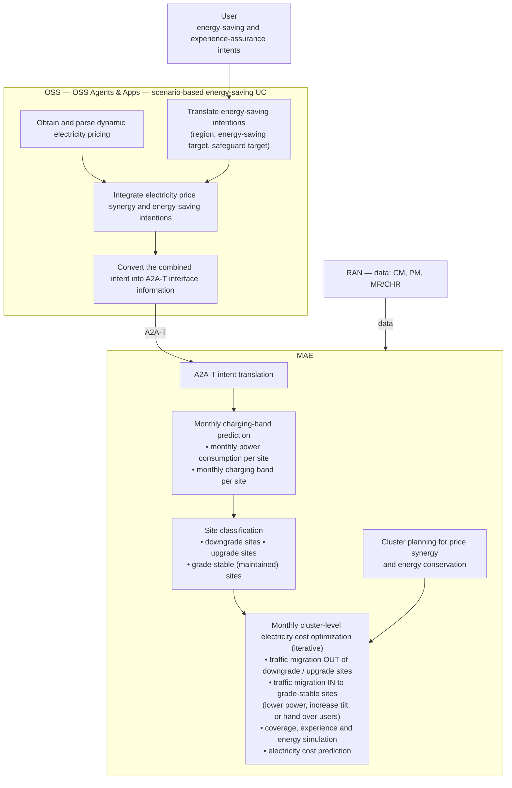

# OpenAN Energy-Saving — Original Use Cases

Transcribed from the original requirement deck,
[`source/Open_AN_UC.pptx`](source/Open_AN_UC.pptx) ("OPEN AN UC", 3 slides).
The deck is the source the LLD and [requirements.md](requirements.md) trace back to.
§3 lists where the LLD differs from it.

---

## UC1 — Electricity price collaboration for energy saving (MTN Power Band Energy Saving)

*Slide 2. In scope.*

### Flow

### Input 1 — Intent schedule (energy saving and experience assurance by time of day)

| Time period (hour) | Energy-saving mode | Experience-assurance target |
|---|---|---|
| 23 – 5 | Maximized energy saving | No rate guarantee target |
| 6 – 9 | Proactive energy saving | 10 Mbps |
| 10 – 15 | Experience first | No degradation |
| 16 – 17 | Proactive energy saving | 10 Mbps |
| 18 – 22 | Experience first | No degradation |

The five periods cover all 24 hours; the first wraps past midnight.

### Input 2 — Power-band tariff

| Band no. | Band (power draw) | Total (GHS) |
|---|---|---|
| 1 | 0.00 – 0.99 kW | 8,247.66 |
| 2 | 1.00 – 1.99 kW | 10,628.25 |
| 3 | 2.00 – 2.99 kW | 11,956.25 |
| 4 | 3.00 – 3.99 kW | 15,409.75 |
| 5 | 4.00 – 4.99 kW | 17,784.09 |

Each site is billed by the band its power draw falls into (currency: Ghanaian
cedi). The deck pairs this with **monthly** charging-band prediction, so the
amount is read here as a monthly charge per site; this needs confirming (O-27).

### What the solution does

1. OSS takes the user's intent schedule and the tariff, combines them, and
   sends one intent to MAE over A2A-T.
2. MAE predicts each site's monthly power consumption and charging band.
3. MAE classifies sites: **downgrade** (can drop to a cheaper band),
   **upgrade** (at risk of moving to a dearer band), **grade-stable** (stays
   in its band).
4. MAE optimizes monthly electricity cost across the cluster: it moves
   traffic off downgrade/upgrade sites and onto grade-stable sites (by
   lowering power, increasing tilt, or handing users over), simulating
   coverage, experience and energy, and predicting cost on each iteration.
5. The intent schedule bounds the optimization: in each time period the
   experience target must hold.

---

## UC2 — Lithium battery charge and discharge planning based on electricity prices

*Slide 3. Out of scope for this release (LLD assumption 11, O-17).*

### Flow

Same OSS side as UC1. In MAE:

1. A2A-T intent translation.
2. Plan lithium-battery charge and discharge periods from the electricity prices.
3. Generate and deliver "staggering electricity usage" MML commands to the RAN.

The RAN applies staggered electricity usage and supplies CM, PM and MR/CHR data.

### Inputs

The same intent schedule as UC1, plus a **time-of-use relative price** table:

| Period (hour) | Relative price |
|---|---|
| 0 – 5 | 1.000 |
| 6 – 9 | 1.176 |
| 10 – 15 | 0.824 |
| 16 – 17 | 1.176 |
| 18 – 21 | 1.765 |
| 22 – 23 | 1.176 |

The price periods do not line up with the intent periods (for example, the
price table splits 18–21 / 22–23 where the intent has 18–22 / 23–5).

---

## 3. Differences between the deck and the LLD

| # | Deck | LLD v10.4 (unchanged from v10.2 on these points) | Consequence |
|---|---|---|---|
| D-1 | UC1 price input is a **power-band tariff** (kW band → charge in GHS). | Price skill returns `price_table[] {start_time, end_time, relative_price}`, which is the **UC2** time-of-use shape. | The price model must support band tariffs for UC1 (R-PRC-5). |
| D-2 | The intent is a **schedule of time periods**, each with a mode and an experience target. | `saving_target` and `experience_target` are single strings. | The intent model and Task-T mapping need a schedule (R-INT-10 … R-INT-12, O-28). |
| D-3 | Modes are an enumeration (maximized / proactive / experience first); experience targets are none, a rate floor (Mbps), or no degradation. | Free-form strings. | Validate against enumerations (R-INT-11). |
| D-4 | All of price parsing, intent integration and A2A-T conversion sit in **OSS Agents & Apps**; OSS talks A2A-T to MAE directly. | Split across OSS, Energy Agent and Orchestration Center (the OpenAN architecture). | Accepted design choice: the Energy Agent and Orchestration Center *implement* "OSS Agents & Apps". |
| D-5 | No negotiation step. | Multi-round feasibility negotiation (FP-002 from the design specification). | Kept, since the specification requires it; with the tariff in the intent, a counter-proposal can be stated in band and cost terms. |
| D-6 | MAE's outputs: per-site predicted band, site classification, cluster plan, predicted electricity cost, traffic-migration actions. | Artifacts named but unspecified (O-11). | These are the expected artifact contents to ask MAE for, and the content of the report (R-RPT-4). |
| D-7 | Optimization is **monthly**, at **cluster** level. | Not stated. | The intent needs a planning month and the region must resolve to a cluster (O-29). |
| D-8 | UC2 is in the deck. | Out of scope. | Unchanged; UC2 is deferred. |
